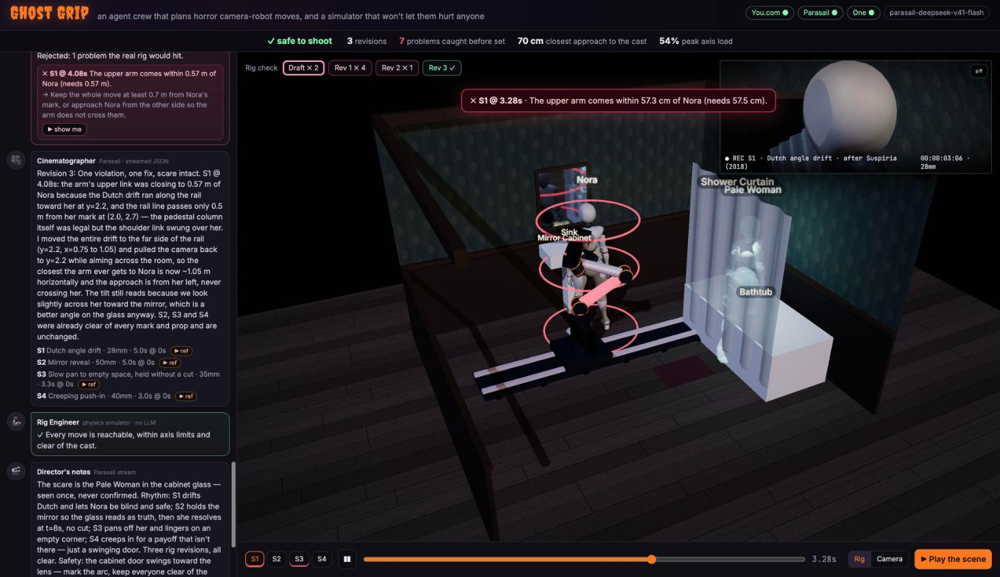
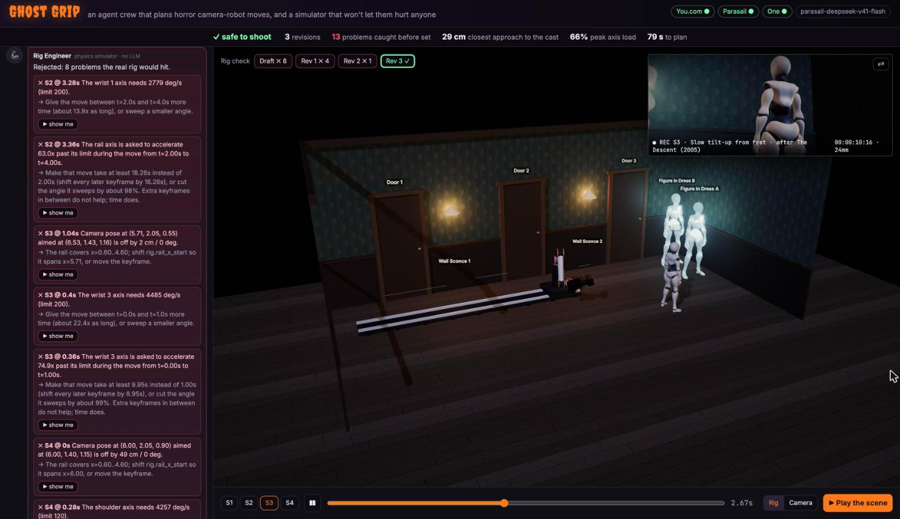

# 🎥 Ghost Grip

**An AI camera-robot crew for horror films.** You describe a scene. A CrewAI crew finds real reference shots on the live web, designs camera moves, and hands them to a robot simulator. The simulator rejects anything a 6-axis motion-control arm can't physically do, and the crew keeps revising until every move is reachable, within speed limits and safe around the actors. You watch the arm perform it in a 3D preview with a picture-in-picture view through the camera's own lens. Then the Producer agent posts the call sheet to the crew's Slack through One (Gmail and Calendar are wired in for when those apps are connected).

Built for **Hack with YOU: Halloween Edition** (Track 3, *The Open Haunt*).


*The draft plan, frozen by the rig simulator: the upper arm (red) would pass 57.3 cm from Nora, inside the 57.5 cm clearance (rings). The agents revised until every move passed.*


*The approved corridor plan after 3 revisions. On the left, the 8 problems the simulator caught in the draft; top right, the shot through the robot's camera.*

## What you see in the demo

- **Crew chat:** each step of the pipeline speaks in the left panel, labelled with the partner that powers it. You see the scene breakdown, the cited references, the technique matches, the shot list, the rig engineer's rejection, and the fix.
- **Rig check strip** (`Draft ✗ 2 · Rev 1 ✗ 1 · Rev 2 ✓`): each revision round is re-simulated on demand. In a rejected round, playback freezes at the moment of each violation. The offending arm link turns red, clearance rings appear around the actor, and the simulator's measurement is shown (for example "upper arm within 57.3 cm of Nora, needs 57.5 cm"). The approved round then plays in green.
- **Reference clips:** every cited film moment gets a playable clip. You.com search finds YouTube candidates, YouTube's oEmbed confirms each one exists and allows embedding (and supplies the real channel name), and the clips are scored to prefer the cited moment and official clip channels. Click a thumbnail, or **▶ ref** on a shot, to play the original next to Ghost Grip's robot-planned version. Clips stream from YouTube's own player and are never downloaded. When nothing embeddable exists, the card says so.
- **Cast:** animated mannequin actors walk their blocking. Ghosts are translucent. The checks use where each actor really is at every sample.
- **Rig ⇄ Camera:** a set view with the robot, and a 2.39:1 camera view with grain, bloom, vignette and a slate. **▶ Play the scene** cuts the approved shots together with beat subtitles and a synthesized drone and sting.
- **Ship it:** the Producer agent posts the call sheet through One, and **⬇ Rig program** downloads the 25 Hz joint program as CSV.

## The problem

Motion-control rigs (robot arms on rails, like the Bolt-style rigs used for VFX plates and jump-scares) make perfectly repeatable camera moves. Programming them is slow, though. A director says *"creep in on her, then whip to the closet on the bang"*. A technician then spends hours turning that into keyframes the arm can reach without hitting the actor or exceeding its axis speeds. Ghost Grip turns the director's sentence into a checked, previewed rig plan in about a minute.

## How it works

```
scene text
   │  Parasail (schema-locked JSON)            → set plan: actors, props, beats
   ▼
Reference Scout agent ── You.com Search + Contents → real film moments with URLs
   ▼
Parasail BGE-M3 embeddings over 28 horror camera techniques → best matches per beat
   ▼
Cinematographer agent (CrewAI, response_format=ShotList → Parasail json_schema)
   ▼                                   ▲
Robot simulator (numpy: IK, min-jerk, │ violations: "forearm comes within 0.31 m of Maya at t=2.4 s —
reach, axis speed/accel, collisions)  │  approach from the other side" → CrewAI @router "revise"
   ▼  feasible (or 3 rounds)          ┘
Director's notes streamed from Parasail → 3D preview + camera POV over WebSocket
   ▼  (on click)
Producer agent ── One MCP → Gmail call sheet + Google Calendar shoot block (+ Discord)
```

### Why each partner is load-bearing

| Partner | What breaks without it |
| --- | --- |
| **CrewAI** | The `GhostGripFlow` (`@start` → `@listen` → `@router`) *is* the product. Its revise loop feeds the simulator's measured violations back to the Cinematographer agent until the plan is physically possible. Three agents have distinct roles and tools: the Scout uses the You.com tools, the Cinematographer has no tools and writes schema-locked output, and the Producer uses One's tools. |
| **You.com** | Every shot cites a real film moment the Scout found through Search (with highlights) and checked with Contents. Without it, the references would be hallucinated. |
| **Parasail** | All reasoning runs here: `parasail-deepseek-v41-flash` runs the agents. Thinking is off by default (`PARASAIL_THINKING=off`), which takes a shot list from ~50 s to ~10 s. The simulator's revise loop catches what a fast draft gets wrong. The shot list is decoded against a JSON schema, BGE-M3 embeddings drive technique retrieval, and the director's notes stream token by token. |
| **One** | The plan leaves the screen: a real Gmail message to the crew and a real Calendar event, built from the approved plan by deterministic tools (`build_gmail_raw`, `build_calendar_event`). |

### The robot

`ghost_grip/robot/` is a UR10-class 6R arm (DH parameters, about 1.3 m reach) on a 0.6 m pedestal that rides a 4 m rail, so 7 degrees of freedom in total:
- **IK:** damped least squares with an analytic Jacobian, plus multi-seed global IK for the first pose.
- **Path:** a Catmull-Rom/Hermite camera path sampled at 25 Hz.
- **Limits:** joint speed and acceleration limits per axis.
- **Collisions:** capsule-vs-capsule checks against actors (with a 0.25 m performer safety margin) and capsule-vs-box checks against props and walls.

Each violation comes back as a sentence an agent can act on.

## Run it

Requirements: Python 3.10–3.13 (CrewAI does not support 3.14), [uv](https://docs.astral.sh/uv/), and Node ≥ 22.23.4 (for One's MCP server).

```bash
cp .env.example .env        # fill in the keys below
make install                # uv sync + pre-fetch @withone/mcp
make smoke                  # proves each partner key works
make run                    # http://localhost:8017  (a full run takes about 1-2 minutes)
make test                   # robot math + flow router + schema tests
```

| Variable | Where |
| --- | --- |
| `YDC_API_KEY` | https://you.com/home → API key |
| `PARASAIL_API_KEY` | https://www.saas.parasail.io/keys (needs credits for inference) |
| `ONE_SECRET` | https://app.withone.ai/settings/api-keys |
| `ONE_CONNECTION_KEYS` | `one --agent list` after `one add gmail` and `one add google-calendar` (optionally `one add discord`) |
| `CALL_SHEET_TO` | default crew email shown in the UI |
| `DISCORD_CHANNEL_ID` | optional; channel for the announcement |
| `PARASAIL_MODEL`, `PARASAIL_EMBED_MODEL`, `PARASAIL_THINKING` | defaults `parasail-deepseek-v41-flash`, `parasail-bge-m3`, `off` |

CLI-only run (no UI): `uv run python -m ghost_grip.crew.flow scenes/1-closet-scare.txt`

Every successful run is saved to `runs/<id>.json`. `http://localhost:8017/?run=<id>` replays it, clearly labelled as a replay: no partner calls are made and nothing is presented as live.

## Repo map

- `ghost_grip/crew/flow.py`: the CrewAI Flow and the revise loop
- `ghost_grip/crew/agents.yaml`: the three agents' roles and backstories
- `ghost_grip/robot/`: arm kinematics, the trajectory planner and collision checks
- `ghost_grip/llm.py`: Parasail (CrewAI LLM, schema JSON, streaming, embeddings)
- `ghost_grip/youcom.py`: You.com Search and Contents, plus the CrewAI tools
- `ghost_grip/retrieval.py`, `library/techniques.json`: technique retrieval
- `ghost_grip/clips.py`: finds, verifies and scores the reference clips (You.com + YouTube oEmbed)
- `ghost_grip/one_actions.py`: the Producer agent on One's MCP tools
- `ghost_grip/server.py`, `web/`: FastAPI with WebSocket events, round re-simulation, CSV export, and the three.js preview
- `web/assets/Xbot.glb`: the mannequin model from the three.js examples (MIT)
